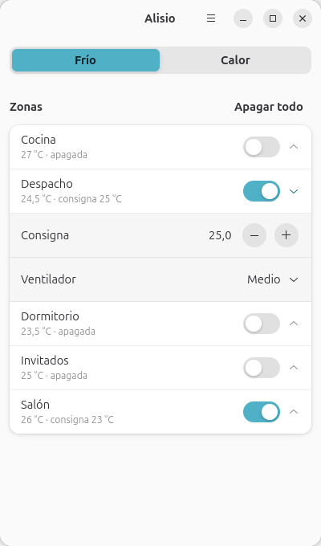
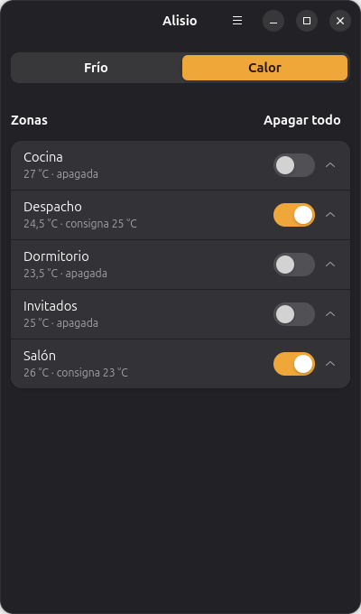

<div align="center">


# Alisio

**El aire acondicionado de Home Assistant, a un clic desde el escritorio de Linux.**

Enciende cada zona, cambia la consigna y el ventilador, y ve al momento lo que
otros cambian desde el móvil o el mando. Sin instalar nada en Home Assistant.

<br>


&nbsp;&nbsp;


<sub>Versión de desarrollo. La interfaz definitiva, con dial, aire animado y bandeja del sistema, está en camino.</sub>

</div>

---

## Qué lo hace distinto

**Lee lo que sabe hacer cada aire.** Alisio no trae una lista de marcas ni pide
`entity_id`: pregunta a Home Assistant qué modos, límites, pasos y velocidades admite
cada clima, y dibuja solo esos controles.

**Entiende los sistemas por conductos.** En instalaciones como Koolnova o Airzone, una
máquina decide frío o calor para toda la casa y las zonas solo se encienden o se apagan.
Alisio lo detecta solo y lo presenta así: el modo arriba y las zonas debajo.

**Cuida las nubes de los fabricantes.** Algunas bloquean la IP de casa si reciben
demasiadas peticiones. Alisio nunca pregunta en bucle, porque Home Assistant le avisa de
cada cambio. Cada gesto es una sola orden, la consigna se envía al dejar de pulsar, y
"Apagar todo" solo habla con las zonas encendidas. Hay pruebas automáticas que cuentan
las peticiones.

**Te dice la verdad.** Lo que tocas se ve al instante, pero la ventana siempre vuelve a lo
que dice Home Assistant. Si una orden se acepta y el aparato no la cumple, Alisio avisa en
vez de fingir.

## Estado

| Fase | Qué incluye | |
| --- | --- | --- |
| 1. Base | Cliente de HA, modelo de capacidades, ventana, Flatpak | ✅ Probada en una casa real |
| 2. Ventana completa | Dial, temporizadores, accesos directos, inicio de sesión por el navegador, descubrimiento en la red | Siguiente |
| 3. Bandeja y escritorio | Icono y menú en la bandeja, avisos, atajo de teclado, inicio con la sesión | |
| 4. Publicación | Español e inglés, ficha y envío a Flathub | |

Todavía no está en Flathub. Mientras tanto se puede compilar desde el código.

## Probarlo desde el código

Hace falta Node 20 o superior, `flatpak` y `flatpak-builder`.

```sh
flatpak remote-add --user --if-not-exists flathub https://dl.flathub.org/repo/flathub.flatpakrepo
flatpak install --user flathub org.gnome.Platform//51 org.gnome.Sdk//51

git clone https://github.com/Juhume/alisio.git && cd alisio
npm install
npm run flatpak        # compila, construye e instala el Flatpak de desarrollo
npm start              # flatpak run io.github.juhume.Alisio
```

Al abrirla, pide la dirección de Home Assistant y un token de acceso de larga duración
(tu perfil de HA → Seguridad). El token se guarda en el llavero del sistema.

¿Sin Home Assistant a mano? `npm run mock` levanta una casa simulada en
`http://127.0.0.1:8124` (token `buen-token`) con una máquina por conductos y cinco zonas.

Para ver qué detecta Alisio en tu instalación sin cambiar nada:

```sh
flatpak run io.github.juhume.Alisio --inventario
```

## Cómo está hecho

GTK 4 y libadwaita, escrito en TypeScript sobre GJS (el JavaScript de GNOME) y empaquetado
con Flatpak.

```
src/ha/       cliente WebSocket de Home Assistant: suscripción, reconexión, órdenes
src/model/    capacidades de cada clima, agrupación de la casa, órdenes y estado optimista
src/ui/       la ventana
tests/        pruebas, y un Home Assistant simulado con una nube que cuenta peticiones
```

La lógica que decide qué órdenes enviar no depende de la interfaz. Así se prueba sin
pantalla, comprobando exactamente qué le llegaría a Home Assistant.

```sh
npm run check     # tipos
npm test          # cliente, modelo y presupuesto de peticiones
npm run test:ui   # la ventana real dentro del Flatpak, contra la casa simulada
```

## Licencia

[GPL-3.0-or-later](COPYING).

---

<details>
<summary><b>English</b></summary>

<br>

**Alisio** is a native Linux app to control your Home Assistant air conditioning from the
desktop: turn each zone on or off, change the target temperature and fan speed, and see
changes made from your phone or remote as they happen. Nothing to install in Home Assistant.

- **Adapts to each device:** it reads the modes, limits and fan speeds each `climate` entity
  supports, and shows only those controls.
- **Understands ducted systems** (Koolnova, Airzone…): it detects a main unit that sets
  cooling or heating for the whole house, and shows the zones underneath.
- **Gentle with vendor clouds:** it never polls. One command per action, the target
  temperature is sent once you stop clicking, and tests count every request.

Built with GTK 4 and libadwaita, written in TypeScript on GJS, packaged as a Flatpak.
In development and not on Flathub yet. See *Probarlo desde el código* above to build it.
Licensed under GPL-3.0-or-later.

</details>
